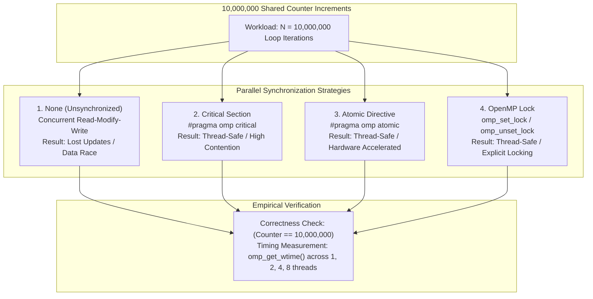
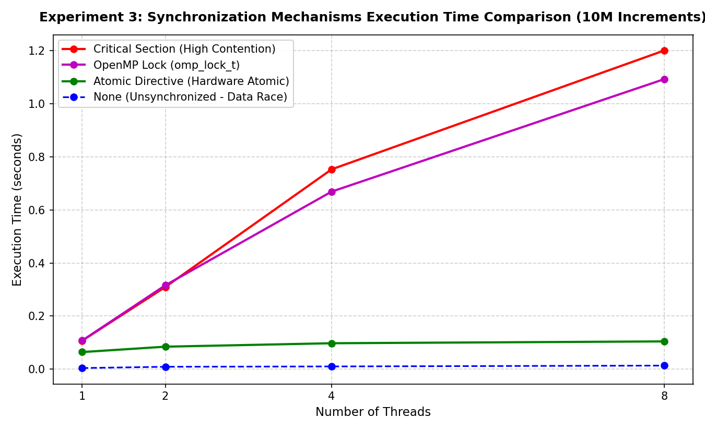
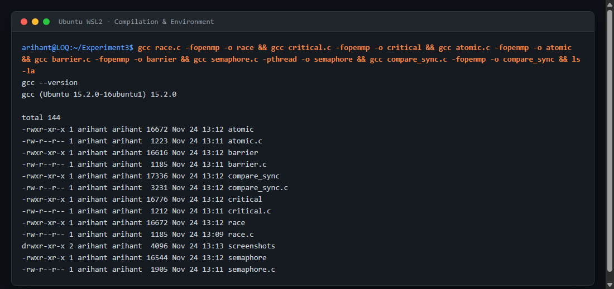
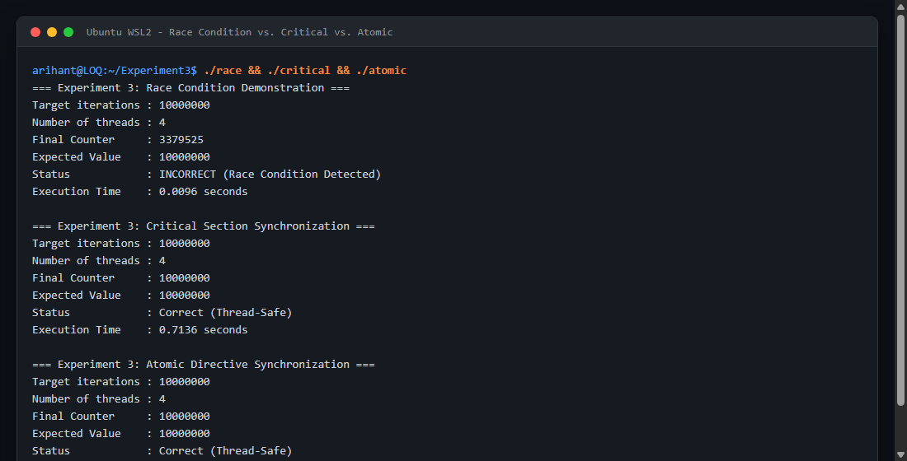
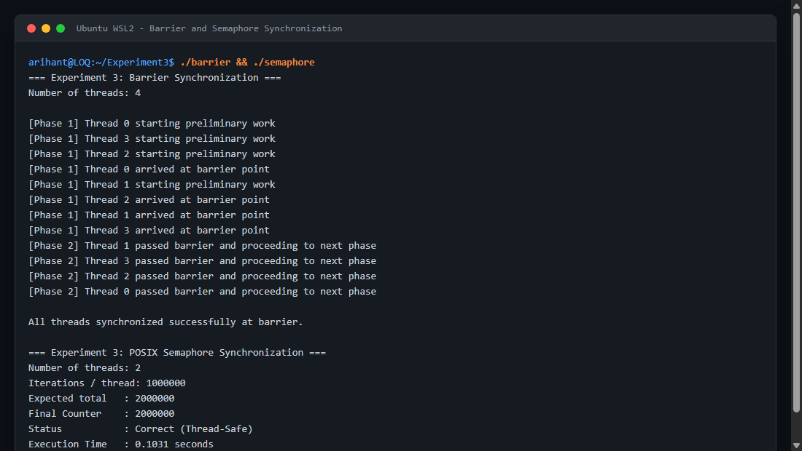
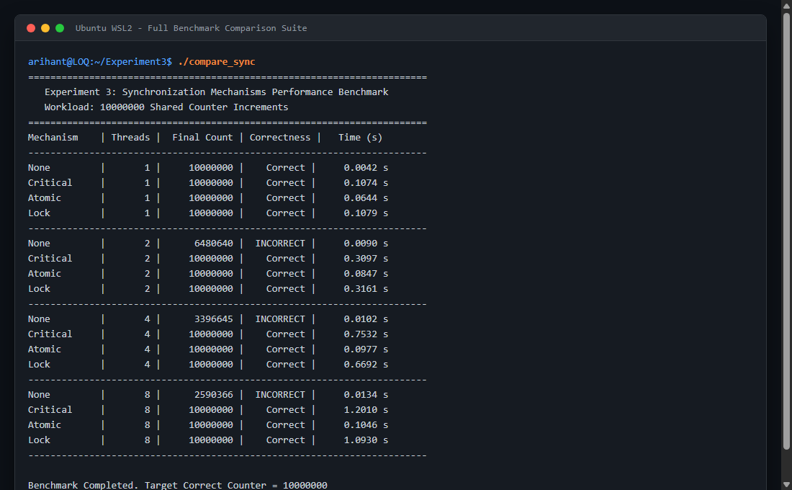

# Experiment 3: Synchronization Mechanisms in Parallel Programs

## Problem Statement
In shared-memory parallel computing, multiple concurrent threads accessing and modifying shared memory variables simultaneously without coordination can cause **data races** and non-deterministic memory corruptions. To guarantee correctness, synchronization primitives must be employed to enforce mutual exclusion, atomic updates, and execution phase barriers. However, synchronization introduces contention and serial bottleneck overheads.

This experiment implements, validates, and compares core synchronization mechanisms across OpenMP and POSIX Threads (Pthreads), evaluating the trade-offs between execution speed and thread-safety under varying levels of thread contention.

---

## Aim and Objectives
- To understand concurrency hazards, specifically **race conditions** in shared-memory multi-threaded execution.
- To implement and evaluate mutual exclusion using **OpenMP Critical Sections** (`#pragma omp critical`).
- To evaluate low-overhead hardware synchronization using **OpenMP Atomic Operations** (`#pragma omp atomic`).
- To evaluate structured lock management using **OpenMP Locks** (`omp_lock_t`).
- To coordinate parallel execution phases across threads using **Barrier Synchronization** (`#pragma omp barrier`).
- To implement thread mutual exclusion using **POSIX Semaphores** (`sem_t`, `sem_wait`, `sem_post`) in Pthreads.
- To benchmark execution time, scalability, and correctness across 1, 2, 4, and 8 threads for 10,000,000 shared counter increments.

---

## Basic Theory in Simple Terms

### 1. What is a Race Condition?
A race condition occurs when two or more threads concurrently read and write to the same memory location without coordination. The final value depends on the non-deterministic scheduling order of the CPU cores:
- Each increment `counter++` is actually three separate machine instructions:
  1. **Read**: Load `counter` from memory into a CPU register.
  2. **Modify**: Increment the register value by 1.
  3. **Write**: Store the updated register value back to memory.
- If Thread A and Thread B read the value `100` at the same time, both calculate `101` and write it back. Two increments occurred, but the counter only increased by 1 (a **lost update**).

### 2. Synchronization Mechanisms

| Mechanism | Technology | How It Works | Best Used For |
|:---|:---|:---|:---|
| **Critical Section** | OpenMP (`#pragma omp critical`) | Restricts execution of a structured block of code to a single thread at any given moment. Other threads wait. | Protecting complex multi-line blocks, data structures, or I/O operations. |
| **Atomic Operation** | OpenMP (`#pragma omp atomic`) | Leverages hardware-level atomic instructions (such as x86 `LOCK XADD`) to perform a single read-modify-write operation atomically without full lock overhead. | Single-variable updates (increments, decrements, accumulator operations). |
| **OpenMP Locks** | OpenMP (`omp_lock_t`) | Explicit programmatic lock variables initialized, acquired (`omp_set_lock`), and released (`omp_unset_lock`) around critical regions. | Granular locking, multiple distinct locks, dynamic locking logic. |
| **Barrier** | OpenMP (`#pragma omp barrier`) | A synchronization point where all threads must arrive before any thread is allowed to continue past the barrier. | Synchronizing parallel execution phases where step 2 depends on step 1. |
| **POSIX Semaphore** | Pthreads (`semaphore.h`) | A kernel- or user-space signaling counter. A binary semaphore initialized to 1 functions as a mutual exclusion lock (`sem_wait` decrements, `sem_post` increments). | Cross-thread signaling and resource-constrained mutual exclusion. |

---

## Hardware and Software Specifications

| Component | Specification |
|:---|:---|
| **Processor (CPU)** | Intel Core i7-13650HX (14 physical cores, 20 logical threads) |
| **Operating System** | Ubuntu Linux (WSL2 environment under Windows 11 64-bit) |
| **Compiler** | GNU Compiler Collection (`gcc` version 15.2.0) |
| **Parallel Standards** | OpenMP API, POSIX Threads (Pthreads), POSIX Semaphores |

---

## System Architecture & Workflow



---

## Program Implementations

| Source File | Synchronization Primitives Used | Description |
|:---|:---|:---|
| [`race.c`](race.c) | None (Unsynchronized) | Demonstrates data races and lost updates when 4 threads concurrently increment a shared variable. |
| [`critical.c`](critical.c) | `#pragma omp critical` | Enforces mutual exclusion using OpenMP critical sections, guaranteeing correctness. |
| [`atomic.c`](atomic.c) | `#pragma omp atomic` | Uses atomic instructions for hardware-accelerated thread-safe scalar updates. |
| [`barrier.c`](barrier.c) | `#pragma omp barrier`, `usleep()` | Demonstrates phase coordination across 4 threads with simulated phase skew. |
| [`semaphore.c`](semaphore.c) | `sem_init()`, `sem_wait()`, `sem_post()` | Demonstrates mutual exclusion using POSIX binary semaphores with 2 worker threads. |
| [`compare_sync.c`](compare_sync.c) | OpenMP, `omp_lock_t`, `omp_get_wtime()` | Systematic multi-thread benchmark across None, Critical, Atomic, and Lock over 10M increments. |

---

## Compilation and Execution Commands

Run the following commands in Ubuntu Linux or WSL:

```bash
# 1. Compile all programs
gcc race.c -fopenmp -o race
gcc critical.c -fopenmp -o critical
gcc atomic.c -fopenmp -o atomic
gcc barrier.c -fopenmp -o barrier
gcc semaphore.c -pthread -o semaphore
gcc compare_sync.c -fopenmp -o compare_sync

# 2. Run individual test programs
./race
./critical
./atomic
./barrier
./semaphore

# 3. Run full multi-threaded performance benchmark
./compare_sync
```

---

## Actual Experimental Results

### Comprehensive Multi-Thread Benchmark (10,000,000 Shared Increments)

*Hardware: Intel Core i7-13650HX, Ubuntu Linux on WSL2, GCC 15.2.0.*

| Mechanism | Thread Count | Measured Final Count | Expected Count | Correctness Verdict | Execution Time (s) |
|:---|:---:|---:|---:|:---:|---:|
| **None (Unsynchronized)** | 1 | 10,000,000 | 10,000,000 | **Correct** | 0.0042 s |
| **Critical Section** | 1 | 10,000,000 | 10,000,000 | **Correct** | 0.1074 s |
| **Atomic Operation** | 1 | 10,000,000 | 10,000,000 | **Correct** | 0.0644 s |
| **OpenMP Lock** | 1 | 10,000,000 | 10,000,000 | **Correct** | 0.1079 s |
| **None (Unsynchronized)** | 2 | 6,480,640 | 10,000,000 | **INCORRECT** | 0.0090 s |
| **Critical Section** | 2 | 10,000,000 | 10,000,000 | **Correct** | 0.3097 s |
| **Atomic Operation** | 2 | 10,000,000 | 10,000,000 | **Correct** | 0.0847 s |
| **OpenMP Lock** | 2 | 10,000,000 | 10,000,000 | **Correct** | 0.3161 s |
| **None (Unsynchronized)** | 4 | 3,396,645 | 10,000,000 | **INCORRECT** | 0.0102 s |
| **Critical Section** | 4 | 10,000,000 | 10,000,000 | **Correct** | 0.7532 s |
| **Atomic Operation** | 4 | 10,000,000 | 10,000,000 | **Correct** | 0.0977 s |
| **OpenMP Lock** | 4 | 10,000,000 | 10,000,000 | **Correct** | 0.6692 s |
| **None (Unsynchronized)** | 8 | 2,590,366 | 10,000,000 | **INCORRECT** | 0.0134 s |
| **Critical Section** | 8 | 10,000,000 | 10,000,000 | **Correct** | 1.2010 s |
| **Atomic Operation** | 8 | 10,000,000 | 10,000,000 | **Correct** | **0.1046 s** |
| **OpenMP Lock** | 8 | 10,000,000 | 10,000,000 | **Correct** | 1.0930 s |

---

## Performance Analysis

1. **Impact of Data Races**:
   - In the unsynchronized run (`None`), single-threaded execution completed correctly with 10M counts.
   - However, at 2 threads, 35.2% of updates were lost (final count: 6,480,640).
   - At 8 threads, **74.1% of updates were lost** (final count: 2,590,366) due to severe overlapping read-modify-write collisions.
2. **Lock & Critical Section Contention**:
   - Both Critical Sections and OpenMP Locks maintained 100% thread safety across all thread counts.
   - However, because only one thread can hold the lock at any time, all other threads stall. As thread count increases from 1 to 8, execution time grows from ~0.107 s to **1.201 s** (an 11.2x slowdown due to bus locking and thread spin/wait overhead).
3. **Hardware Efficiency of Atomic Operations**:
   - The `#pragma omp atomic` directive avoids software-managed lock structures, instructing the compiler to generate hardware-supported atomic bus/cache lock instructions (e.g., `LOCK XADD` on x86-64).
   - Even under heavy 8-thread contention, atomic increments completed in **0.1046 seconds** — performing **11.5x faster** than `#pragma omp critical` (1.2010 s) while ensuring 100% correct output.

---

## Performance Graph

The graph below visualizes the execution time scaling of all four mechanisms as thread count increases from 1 to 8:



---

## Actual Execution Screenshots

### 1. Build and Environment Verification
Compiling all six C programs with GCC 15.2.0 on Ubuntu WSL2:



### 2. Race Condition vs. Critical Section vs. Atomic Update
Execution of `race` (demonstrating lost updates: 3,379,525), `critical` (thread-safe: 10,000,000 in 0.7136 s), and `atomic` (thread-safe: 10,000,000 in 0.1580 s):



### 3. Barrier and POSIX Semaphore Synchronization
Execution of `barrier` demonstrating coordinated thread phases, and `semaphore` demonstrating POSIX binary semaphore mutual exclusion:



### 4. Full Synchronization Benchmark Suite
Execution of `compare_sync` showing complete benchmark data across 1, 2, 4, and 8 threads:



---

## Repository Structure

```
PGC-L3-Synchronization-Mechanisms/
├── .gitignore                      # Git ignore rules for compiled binaries
├── README.md                       # Comprehensive experiment documentation & results
├── race.c                          # Unsynchronized counter demonstrating race conditions
├── critical.c                      # OpenMP critical section mutual exclusion
├── atomic.c                        # OpenMP atomic directive hardware synchronization
├── barrier.c                       # OpenMP barrier coordination demonstration
├── semaphore.c                     # POSIX binary semaphore mutual exclusion
├── compare_sync.c                  # Multi-threaded benchmark comparison across 1-8 threads
└── screenshots/
    ├── 01_compilation_and_environment.png
    ├── 02_race_vs_critical_vs_atomic.png
    ├── 03_barrier_and_semaphore.png
    ├── 04_compare_sync_benchmark.png
    └── 05_sync_performance_chart.png
```

---

## Conclusion
Experiment 3 clearly demonstrates the mechanics, necessity, and performance implications of synchronization in parallel programming:
1. Unsynchronized multi-threaded access to shared variables results in severe data corruption (up to 74% lost updates at 8 threads).
2. Critical sections and mutex locks guarantee data consistency but experience substantial serialization contention under heavy load.
3. Atomic operations provide the best performance and scalability for scalar updates, outperforming critical sections by **11.5x at 8 threads** by leveraging native processor cache-coherence atomic primitives.
4. Barrier synchronization provides clean phase separation across cooperating threads without race hazards.
